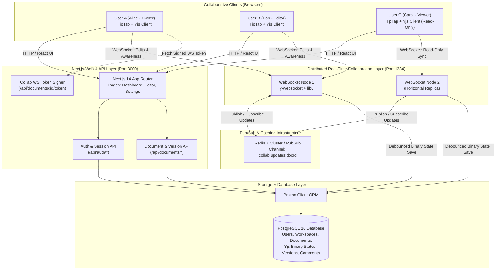
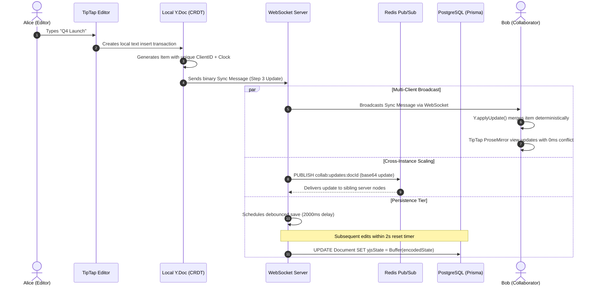

# Architecture & System Design Document
## Real-Time Collaborative Workspace (SyncSpace)

---

### 1. Executive Overview

SyncSpace is a production-grade, distributed real-time collaborative workspace inspired by modern collaborative platforms like Notion and Figma. It enables multiple concurrent users to view, edit, comment, and inspect version histories of rich-text documents without race conditions, overwrites, or data loss.

The system is architected around four core pillars:
1. **Mathematical Concurrency via CRDTs**: Using Yjs Conflict-free Replicated Data Types to resolve simultaneous character and block operations deterministically without centralized locks.
2. **Sub-150ms WebSocket Wire Protocol**: Real-time broadcast of document sync vectors, live colored caret positions, and presence awareness across clients.
3. **Horizontal Scaling via Redis Pub/Sub**: Multi-server cross-instance coordination ensuring users connected to different WebSocket servers collaborate seamlessly.
4. **Resilient Dual-Tier Persistence**: Rapid in-memory editing backed by debounced, binary-compressed state serialization in PostgreSQL via Prisma.

---

### 2. High-Level Architecture Diagram



---

### 3. Detailed Data Flow: User Edit to Convergence



---

### 4. CRDT Concurrency Mechanism (Why CRDTs over OT)

#### Operational Transformation (OT) Limitations
- Centralized authority requirement: All edits must pass through a single coordinator server to establish linear order.
- High complexity for peer-to-peer or multi-server scaling.
- Fragile offline synchronization: High frequency of merge race conditions when clients reconnect after temporary network disconnects.

#### Yjs CRDT Mathematical Foundation
Yjs represents text and document structures as a doubly linked list of immutable items. Each item is indexed by:
- **Client ID**: A unique 53-bit integer assigned to the client.
- **Clock**: A monotonically increasing Lamport logical timestamp.
- **Left / Right Origins**: Reference to adjacent items at time of insertion.

When two clients insert text at the identical offset simultaneously:
1. Client A creates `Item(Client: 101, Clock: 14)`.
2. Client B creates `Item(Client: 202, Clock: 9)`.
3. When updates cross, Yjs compares `(Clock, ClientID)` lexicographically.
4. Both clients place the items in the exact same deterministic order, guaranteeing **Strong Eventual Consistency (SEC)**.

---

### 5. Multi-Instance Scaling via Redis

To scale beyond a single Node.js process:
1. Each collaboration server instance generates a unique `INSTANCE_ID`.
2. When an update arrives from a connected WebSocket client, the server publishes a message to `collab:updates:${documentId}` containing:
   ```json
   {
     "originInstanceId": "collab-node-a1b2",
     "docId": "clt92x8100...",
     "updateBase64": "AQX8...",
     "timestamp": 1728645000000
   }
   ```
3. Sibling servers subscribed to that channel receive the message. They verify `originInstanceId !== this.instanceId` (avoiding reflection loops) and apply the update to their in-memory `Y.Doc` with origin `'redis'`.
4. This immediately broadcasts the update to all clients connected to the sibling node!
5. **Resilient Offline Fallback**: If Redis is not running (e.g. initial zero-dependency local development), the server automatically operates in standalone mode without throwing exceptions or crashing.

---

### 6. Role-Based Access Control (RBAC) Enforcement

Permissions are strictly enforced at **two distinct boundaries**:
1. **REST API Boundary**: All endpoints check user session, workspace membership, and role permissions.
2. **WebSocket Handshake & Message Wire Boundary**:
   - Clients must present a signed, short-lived JWT token containing `userId`, `role`, and `documentId`.
   - Unauthorized connections are rejected with WebSocket code `401 / 4001`.
   - For `VIEWER` or `COMMENTER` roles, the WebSocket server marks the connection as **read-only**. Any binary edit messages (Sync Type 2) attempted by the client are immediately dropped.

| Role | Delete Workspace | Manage Members | Create Documents | Edit Content | Add Comments | View Content |
| :--- | :---: | :---: | :---: | :---: | :---: | :---: |
| **OWNER** | ✅ | ✅ | ✅ | ✅ | ✅ | ✅ |
| **ADMIN** | ❌ | ✅ | ✅ | ✅ | ✅ | ✅ |
| **EDITOR** | ❌ | ❌ | ✅ | ✅ | ✅ | ✅ |
| **COMMENTER** | ❌ | ❌ | ❌ | ❌ | ✅ | ✅ |
| **VIEWER** | ❌ | ❌ | ❌ | ❌ | ❌ | ✅ |

---

### 7. Dual Database Compatibility

The system is engineered to work flawlessly in both development and production environments:
- **Default Development**: Zero-dependency SQLite engine (`file:./dev.db`) allowing instant local execution in VS Code without requiring Docker or manual database installation.
- **Production / Docker**: Enterprise PostgreSQL 16 schema (`prisma/schema.postgres.prisma`) with `docker-compose.yml` for containerized deployments with high concurrency and pooling.
